# 分寸 · Measure

**中文** · [English](README.en.md)

<div align="center">
  <a href="https://github.com/dososo/blcaptain-measure-cjk/releases/download/v0.1.0/measure-launch-v0.1.0.mp4">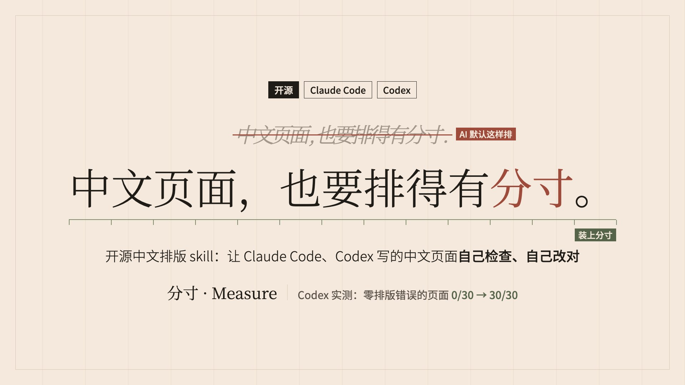</a>
  <br><sub><b>▶ 点图观看 40 秒发布片</b>（MP4，约 11 MB，附在 <a href="https://github.com/dososo/blcaptain-measure-cjk/releases/tag/v0.1.0">v0.1.0 Release</a> 里）</sub>
</div>

[](LICENSE)  [](https://www.npmjs.com/package/measure-cjk) 

> 让 Claude Code、Codex 写出来的中文页面**排得有分寸**：排版对、字体合法，而且能用校验器证明。

<div align="center">
  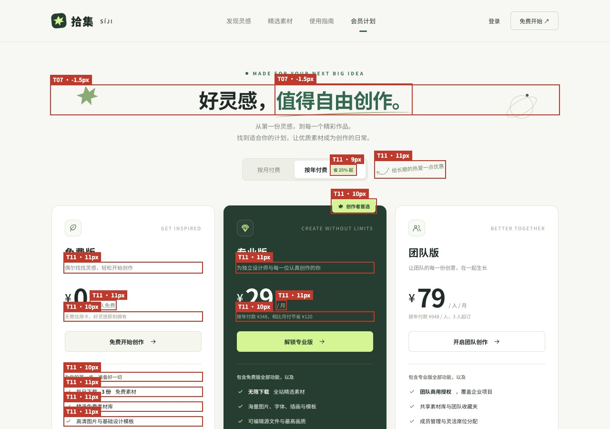
  <br><sub><b>不装 measure 时 Agent 生成的价格页</b>：红框是 <code>measure-cjk lint --render</code> 查到的问题，标签是规则编号和截图里量到的字号，最小的中文只有 9px</sub>
</div>

> **▶ 在线展示页**：<https://dososo.github.io/blcaptain-measure-cjk/site/> —— 实验数字、7 条规则的示意对比、4 组真实页面、6 个主题。

---

## 为什么做这个

AI 写出来的中文页面，大面上已经不差，差在细节：价格旁的小字只有 9px，标题字距是负的，中英文挤在一起，半角逗号夹在汉字中间，字体随手写了一个不能商用的。这些问题不显眼，读久了却很累；字体用错了，还有授权风险。

英文世界已经有很多「设计品味」skill，但它们不管中文：中文的行长、行高、标点、字距、字体授权，规则完全不同。**分寸**补的就是这一层：一份给 Agent 读的中文排版规则，加一个能在真实浏览器里检查结果的校验器 `measure-cjk`。

> 诚实前提：measure 衡量的是「有没有遵守这套中文排版规则」，不是审美打分；字体授权表是核验过的数据，但**不是法律意见**。

---

## 实测：装上之后，差别有多大

同一个 Agent、同一个模型，30 条中文页面提示词（落地页、文章页、价格页、文档页、表单页、小红书卡片），装和不装 measure 各生成一次，用 measure 的完整档检查（2026-10-26）：

| | Codex（gpt-6-astra） | Claude Code（claude-opus-5-5） |
|---|---|---|
| 零 error 页面（全部规则） | 0/30 → **30/30** | 0/30 → **27/30** |
| 零 error 页面（排除 T02、T04） | 0/30 → **30/30** | 15/30 → **27/30** |
| 同一条提示词逐条比（排除 T02、T04） | 更好 30、一样 0、更差 0；p < 0.0001 | 更好 14、一样 14、更差 2；p = 0.0042 |

- **评分用的是 measure 自己的校验器**，衡量的是遵守 measure 规则的程度，不是独立的审美评价。
- T02（中英文间距）、T04（行首禁则）是本项目定的规则，AI 默认几乎不写，所以同时给出排除这两条的数字。
- Claude Code 那一列有 5 页小红书卡片：T11（字号太小）按浏览器像素判断卡片，口径有问题、正在修。如果这 5 页不算违规，排除 T02、T04 的逐条比会变成 9 / 18 / 3，p ≈ 0.146，不再显著。
- 方法、原始数据和三轮独立审计见 [`docs/verification/w2/northstar/`](docs/verification/w2/northstar/)。

---

## 五个设计支柱

1. **规则可验证** —— 不是「建议这样写」，而是 lint：基础档读源码，离线运行；完整档用浏览器在 360–1440px 六种宽度下实测，每条 error 都附截图。
2. **字体授权四档** —— 🟢 可嵌入 / 🔵 可出图 / 🟡 只能系统调用 / 🔴 要商业授权；每一款都附官方原文链接和核验日期；维护者的校验脚本在核验超过 180 天时会提醒复核。
3. **只修排版，不改文案** —— Agent 只能动空格、标点宽度和 CSS，措辞不经你同意不改。
4. **不关规则、不加 `--force`** —— 要关某条规则，必须在配置里写明理由。
5. **出图只用能商用的字体** —— 小红书卡片导出时，逐个元素查浏览器实际用到的字体，用到不能商用出图的就不出图。

---

## 规则示意

> 以下是**示意**：同一段文字，「关」只差一条规则，「开」是按 measure 改好的版本，两版都用 `measure-cjk lint --render` 验证过。

<table>
<tr>
<td width="50%">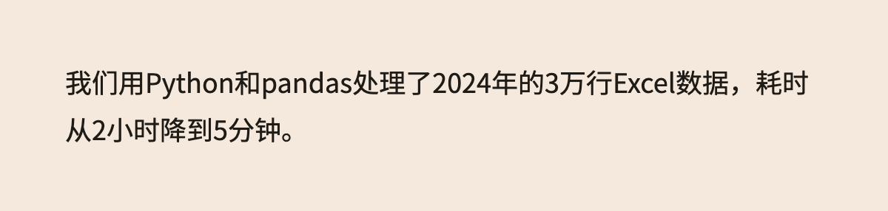<br>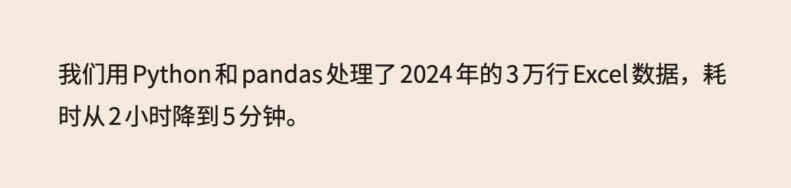<br><b>T02 中英文、数字之间要有间距</b>：上「关」下「开」，靠 <code>text-autospace</code> 自动留空隙</td>
<td width="50%">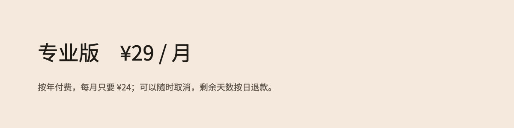<br>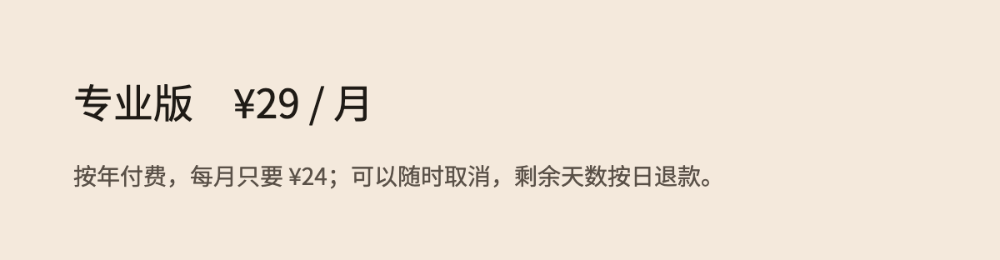<br><b>T11 最小字号</b>：10px 的汉字笔画会糊成一团，任何中文不小于 12px，正文不小于 14px</td>
</tr>
</table>

全部 7 条（T02、T03、T05、T06、T07、T08、T11）见[在线展示页](https://dososo.github.io/blcaptain-measure-cjk/site/#rules)。

---

## 6 个主题（同一套规则，换一套视觉）

> 每个主题一个文件（不超过 8 KB）：设计变量、字号阶梯（字号越大字重越轻）、字体栈、该做和不该做。点图打开示例页。

<table>
<tr>
<td width="33%"><a href="https://dososo.github.io/blcaptain-measure-cjk/site/themes/broadsheet.html">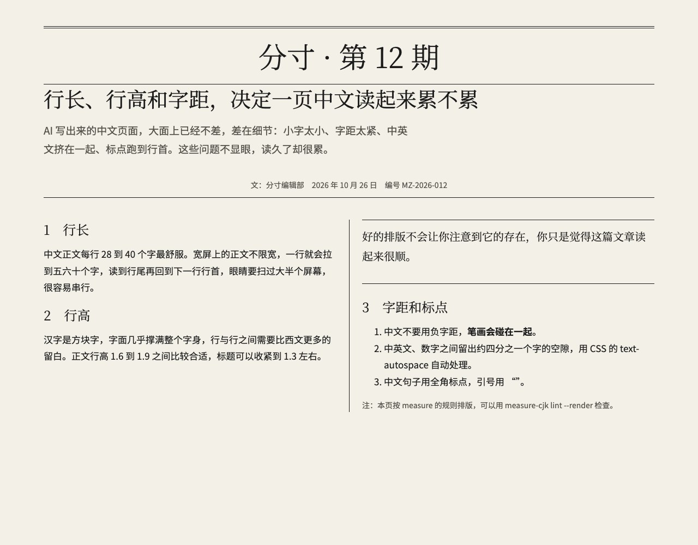</a><br><b>① 报刊 Broadsheet</b> —— 宋体标题、黑体正文、分栏和栏线</td>
<td width="33%"><a href="https://dososo.github.io/blcaptain-measure-cjk/site/themes/manual.html">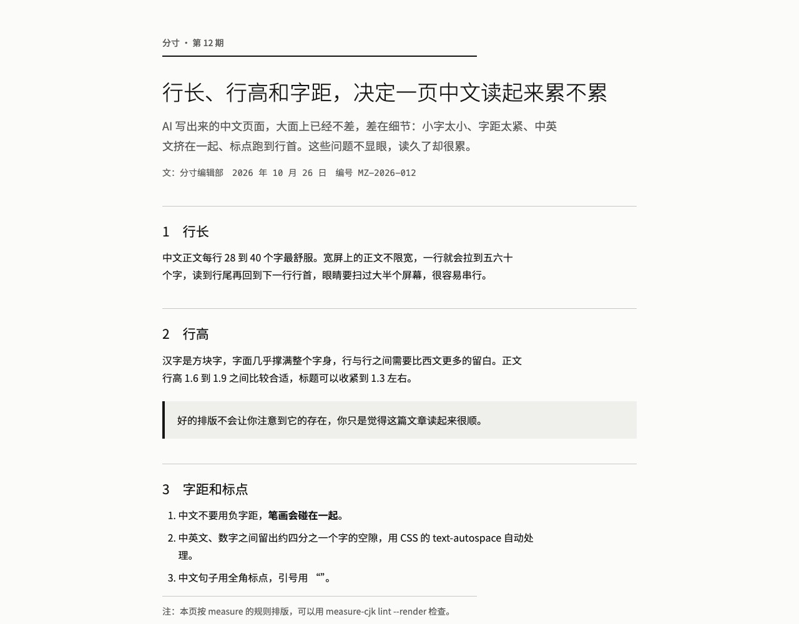</a><br><b>② 说明书 Manual</b> —— 全黑体、编号体系、单色</td>
<td width="33%"><a href="https://dososo.github.io/blcaptain-measure-cjk/site/themes/archive.html">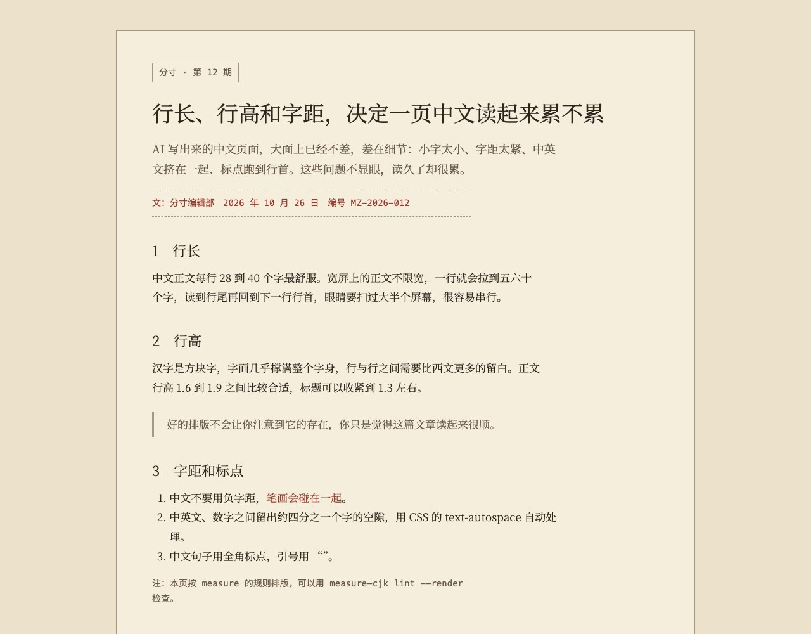</a><br><b>③ 档案 Archive</b> —— 牛皮纸、编目号、等宽加宋体</td>
</tr>
<tr>
<td><a href="https://dososo.github.io/blcaptain-measure-cjk/site/themes/quarterly.html">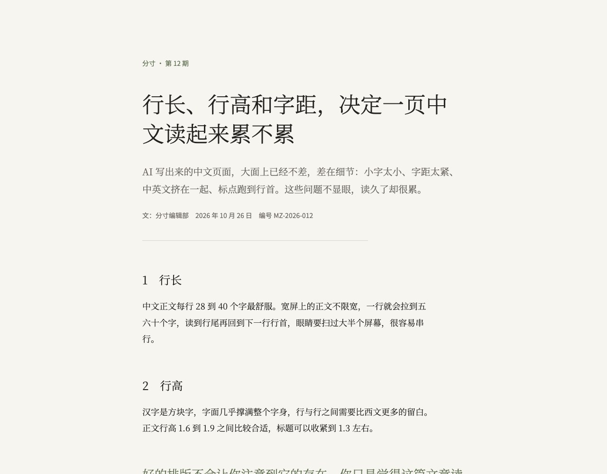</a><br><b>④ 季刊 Quarterly</b> —— 大留白、宋体正文、细字重</td>
<td><a href="https://dososo.github.io/blcaptain-measure-cjk/site/themes/songke.html">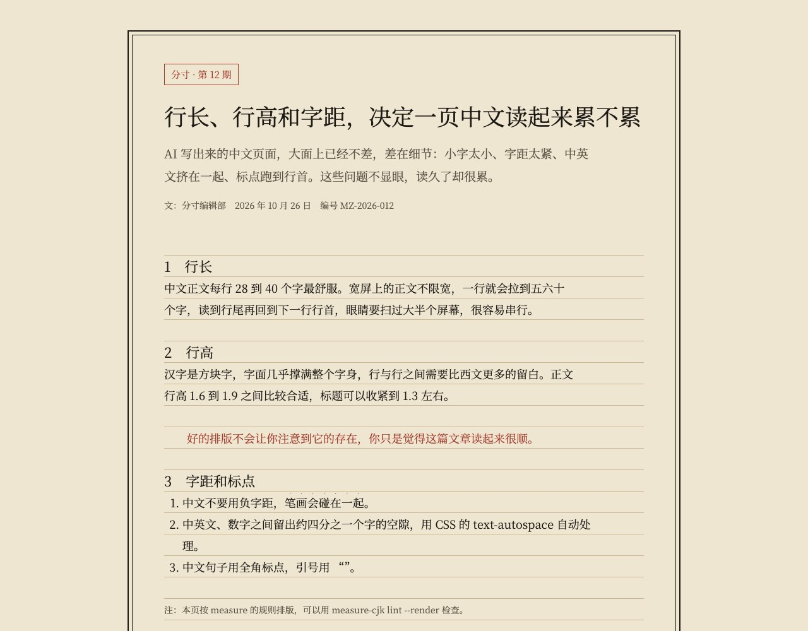</a><br><b>⑤ 宋刻 Songke</b>（传统风）—— 界栏、版框、着重号</td>
<td><a href="https://dososo.github.io/blcaptain-measure-cjk/site/themes/dososo.html">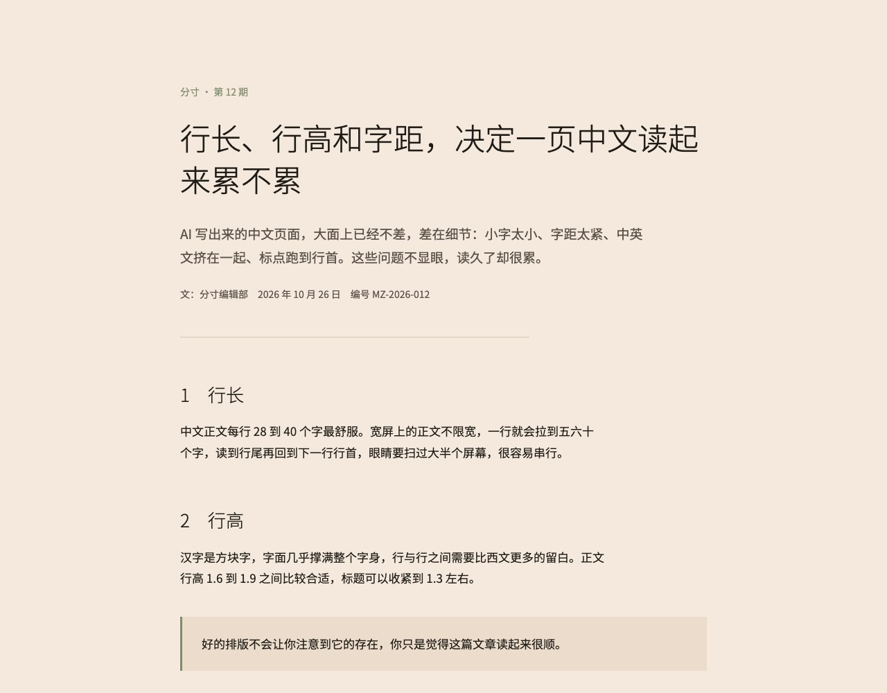</a><br><b>⑥ 分寸 Dososo</b>（传统风）—— 米纸、墨、青瓷、朱砂</td>
</tr>
</table>

主题文件在 [`skills/measure/references/themes/`](skills/measure/references/themes/)。

---

## 安装

**最简单 · 对话式**：把本仓库地址发给你的 Agent，让它安装：「安装 `https://github.com/dososo/blcaptain-measure-cjk` 这个 skill」。

| Agent | 安装 skill |
|---|---|
| Claude Code | `/plugin marketplace add dososo/blcaptain-measure-cjk`，再 `/plugin install measure@blcaptain-measure-cjk` |
| Codex | `codex plugin marketplace add dososo/blcaptain-measure-cjk`，再 `codex plugin add measure@blcaptain-measure-cjk` |
| 其他 Agent | `npx skills add dososo/blcaptain-measure-cjk`（需要 Node 22.20 或以上） |

**校验器**单独发布在 npm 上（skill 里会先找 `measure-cjk` 命令，找不到再用固定版本的 `npx`）：

```bash
npm install -g measure-cjk
measure-cjk --version
```

**手动 · 本地**：

```bash
git clone https://github.com/dososo/blcaptain-measure-cjk && cd blcaptain-measure-cjk
npm install && npm run build
scripts/install_skill_links.sh   # 软链到 ~/.claude/skills 和 ~/.agents/skills
npm install -g ./packages/cli    # 把本地构建的校验器放到 PATH 上
```

Codex 会在 `~/.agents/skills/`、`$CODEX_HOME/skills/` 里找 skill（codex-cli 0.154.0 实测）；项目里的 `.agents/skills/` 是否也会被发现，没有单独测过，待确认。三种安装方式的本机试装记录见 [`docs/verification/w2/install/INSTALL_CHECK.md`](docs/verification/w2/install/INSTALL_CHECK.md)。

**完整档和 `card` 需要 Playwright**（可选依赖；不装就不能用 `--render`，不会悄悄降级成基础档）：

```bash
npm install -D playwright && npx playwright install chromium
# 本机已经装了 Chrome 或 Edge 时，也可以只装 playwright-core（不下载浏览器）
npm install -D playwright-core
```

---

## 使用校验器

```bash
measure-cjk lint dist/                                   # 检查目录或文件（.html / .htm / .css）
measure-cjk lint dist/ --render                          # 完整档：浏览器在 6 种宽度下实测，error 附截图
measure-cjk lint http://localhost:3000 --render          # 检查开发服务器；远程地址必须加 --allow-remote
measure-cjk lint dist/ --format json --out measure-results.json
measure-cjk fonts "阿里巴巴普惠体"                        # 查字体授权
measure-cjk card card.html --out card.png --font-dir fonts   # 导出小红书 3:4 卡片
measure-cjk init                                         # 生成 measure.config.json 和 measure.css
measure-cjk rules                                        # 列出全部规则
```

**退出码：** 0 表示通过，或者没有中文内容；1 表示有 error；2 表示用法或环境错误、没检查完（例如页面超时、用了 `--render` 但没装 Playwright）。没有 `--force`。`--out` 只能写工作区内的 `.json` 文件。要关闭某条规则，只能在配置里写明理由：

```json
{ "schema_version": "1.0.0", "disabled": { "T07": "品牌规范要求标题紧排" } }
```

### 小红书卡片（`card`）

- 导出 1080×1440 的 PNG，需要 Playwright。三种模板在 [`skills/measure/assets/cards/`](skills/measure/assets/cards/)：图文封面、清单卡、引语卡。
- 字体只用 `font_dir` 里的字体文件，按文件里的名字查授权表，只有可以商用出图的（🟢、🔵）才会加载；浏览器实际用到的每一款字体，包括缺字时回退的系统字体，都要过授权表，否则不出图。
- 卡片的 lint 和导出是同一次渲染；页面自带的字体、canvas、iframe、含文字的 SVG 图片等查不到字体的内容，判为没检查完。
- 要求署名的字体（例如 MiSans）会在结果里附上署名提示。

### 基础档的局限（请务必了解）

- **只解析 `.html`、`.htm`、`.css`。** React、Vue、Tailwind 项目要先构建，再对产物运行；v0.1 不直接解析 JSX 或 TSX 源码。
- **层叠计算是近似的。** 已经处理：浏览器默认样式、页面样式、`style` 属性、选择器优先级（`:where()` 记为 0）、`@layer`、CSS 嵌套、继承、em / rem / % 换算、`font` 简写、CSS 变量。`@media` 分桌面 1280×800 和窄屏 390×844 两个视口求值；不计算 `calc()`、`clamp()`；T05 行长只能估算（只报 warn）。要准确结果，用完整档。
- **单独传入的 `.css` 文件只检查 `@font-face` 授权（F03）。** 远程样式表和远程字体不会下载，只记录在 `run.remote_refs` 里。
- **字体名前缀匹配是启发式的**：全大写的西文名（如 `HYPERLEGIBLE`）仍可能被误判为汉仪或方正。

### 引入 measure.css

`measure.css` 整体放在 `@layer measure` 里，选择器优先级为 0。**在入口 CSS 的第一行写 `@layer measure;`**，这样直接写在元素上的样式（包括 Tailwind v4 的 `@layer utilities`）都会优先于它。`measure.css` 直接作用在每个中文元素上，写在 `body` 上、靠继承传下来的 `line-height`、`line-break` 会被它盖掉；要改这些属性，请写在中文元素或 `:lang(zh)` 上。

---

## 隐私与安全

- **默认零网络请求**：源码里没有网络或子进程模块（有静态检查测试），运行时测试也会拦截所有网络入口。完整档检查本地文件时只读工作区内的文件，连 localhost 也不访问；检查远程地址必须显式加 `--allow-remote`。
- **路径先校验再读写**：所有路径先做 realpath 并解析符号链接，指向工作区以外的一律拒绝；结果文件原子写入；`init` 不覆盖已有文件。
- **页面内容只是数据**：基础档不执行页面脚本；完整档在隔离的浏览器环境里打开页面，测量代码不受页面脚本影响。页面里出现的「指令」一律不执行。
- **完整档会加载 Playwright**：先找和 measure-cjk 装在一起的，再找当前项目里装的。所以不要在不信任的目录里运行 `--render`，那个目录里的 `node_modules/playwright` 会被当作代码执行。
- **仓库不包含任何字体文件。** 测试用代码生成的方框字体；展示页截图用的思源字体、Noto emoji 和符号字体（都是 OFL-1.1）放在仓库之外。

---

## 后续计划（Roadmap）

- **规则修正**：T06 对单行元素（价格标签、品牌名）的误报；T11 对小红书卡片按导出尺寸判断；修好后在北极星实验的产物上补算附加列。
- **A 系列反模式**：中文 AI 味的静态规则（A02–A07、A09、A12），目前只有文档。
- **更多场景**：公众号（P1，官方限制要先实测）、Typst / PDF。
- **发布体积**：插件和仓库一起分发时会带上实验数据，计划拆出精简的发布目录。
- 详见 [`ROADMAP.md`](ROADMAP.md)。

---

## FAQ

**装了 measure，页面就一定好看吗？** 不一定。measure 保证的是中文排版的底线：字够大、行够宽、标点对、字体能用。好不好看还取决于设计本身；可以从 6 个主题里选一套起步。

**会不会改我的文案？** 不会。Agent 只能动空格、标点宽度和 CSS，措辞不经你同意不改。

**字体授权表可信吗？** 每一款都附官方原文链接和核验日期，`fonts` 的输出里也带核验日期；维护者的校验脚本（`scripts/validate-skill.mjs`）在核验超过 180 天时会失败，提醒复核；但它**不是法律意见**，商用前请以字体厂商的原始条款为准。

**完整档要联网吗？** 不用。检查本地文件时完全离线（第一次用 `npx` 获取校验器、安装 Playwright 时需要访问 npm）；只有你显式传入远程地址并加 `--allow-remote` 时才访问网络。

---

## 开发

```bash
npm install
npm run build        # 同步授权表、measure.css 和授权文件到包内，再编译 TypeScript
npm test             # node:test
node scripts/validate-skill.mjs
node bench/showcase-build.mjs && node site/_build.mjs   # 重新生成展示页（需要仓库外的思源字体，见 site/ 的说明）
```

---

## 关于作者

**分寸 · Measure** 由 **爆裂队长NEXT（BLCaptain）** 独立创作与维护。

- GitHub：[@dososo](https://github.com/dososo)
- X / Twitter：[@thinkszyg](https://x.com/thinkszyg)
- 邮箱：blteam2026@outlook.com

欢迎在 [Issues](https://github.com/dososo/blcaptain-measure-cjk/issues) 提反馈、提需求。如果这个项目对你有用，欢迎 Star。

---

## License

- 代码：Apache-2.0（[LICENSE](LICENSE)）
- 文档、规则文本、主题文本、`data/`：CC BY 4.0（[LICENSE-docs](LICENSE-docs)）
- 第三方依赖和 W3C 材料的声明见 [NOTICE](NOTICE)

字体授权表不是法律意见；商用发布前请自行核验所用字体的授权状态。
